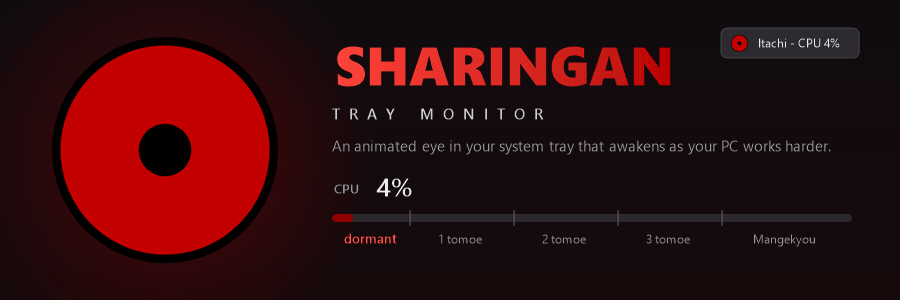
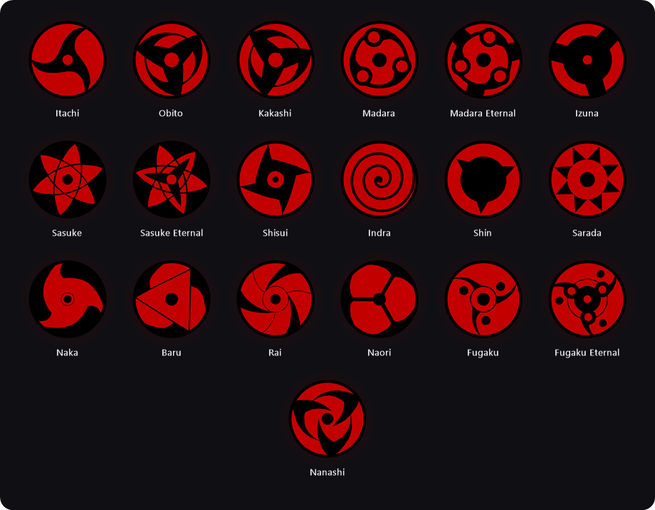

<p align="center">
  
</p>

<p align="center">
  <a href="#requirements"></a>
  <a href="#requirements"></a>
  <a href="LICENSE"></a>
  <a href="https://buymeacoffee.com/boode"></a>
</p>

<p align="center">
  An animated Sharingan that lives in your Windows system tray and reacts to real system load.<br>
  The eye awakens as your machine works harder: one tomoe, then two, then three, then Mangekyou.<br>
  <b>Pure PowerShell.</b> No installer, no dependencies, no compiled binaries. One script you can read top to bottom.
</p>

<p align="center">
  <a href="#download"><b>Download</b></a> &nbsp;&bull;&nbsp;
  <a href="#how-it-reacts"><b>How it reacts</b></a> &nbsp;&bull;&nbsp;
  <a href="#using-it"><b>Using it</b></a> &nbsp;&bull;&nbsp;
  <a href="#the-eyes"><b>The eyes</b></a> &nbsp;&bull;&nbsp;
  <a href="#how-it-works"><b>How it works</b></a> &nbsp;&bull;&nbsp;
  <a href="#support"><b>Support</b></a>
</p>

<p align="center"></p>

<a id="download"></a>

##  Download and install

*Three steps to awaken it, and one double-click to have it start with Windows. Never used GitHub before? Just follow along.*

<p align="center">
  
</p>

1. **Download** it either way:
   - the green **Code** button near the top of this page, then **Download ZIP**, or
   - [**Releases**](https://github.com/boode-hub/Sharingan-Monitor/releases/latest), then `Sharingan-Tray-Monitor-v2.0.zip`
     (just the five files you need).
2. Right-click the downloaded ZIP, choose **Extract All**, and pick any folder.
3. Open that folder, right-click **Sharingan.ps1**, and choose **Run with PowerShell**
   (on Windows 11 it may sit under **Show more options**).

The eye appears in your system tray straight away. Right-click it for the menu.

> [!CAUTION]
> A PowerShell window opens with it. Minimise it, don't close it: closing it closes
> the eye. To run it hidden, let it start with Windows (below).

> [!TIP]
> **If Windows blocks it:** right-click the ZIP *before* extracting, choose
> **Properties**, tick **Unblock**, then extract. Windows flags files downloaded from
> the internet, and this clears that flag.

### Start with Windows, remove any time

| Double-click | What it does |
| --- | --- |
| `install-startup.bat` | Starts the eye now, hidden, and every time you log in. |
| `remove-startup.bat` | Takes it out of startup and stops it. Your settings stay. |

No installer and no administrator rights: it adds one per-user startup entry, and
`remove-startup.bat` deletes it again. Outside its own folder nothing else changes,
so trying it is risk-free.

**Prefer the command line?**

```
powershell -ExecutionPolicy Bypass -File Sharingan.ps1
```

<p align="center">
  <sub>The eye is open? If it made you smile, a coffee keeps new eyes coming.</sub><br>
  <a href="https://buymeacoffee.com/boode"></a>
</p>

<p align="center"></p>

<a id="how-it-reacts"></a>

##  How it reacts

*Load is chakra. The harder your machine works, the further the eye awakens.*

| CPU / RAM load | | Eye |
| --- | :---: | --- |
| below 15% |  | dormant, no tomoe |
| 15% |  | 1 tomoe |
| 35% |  | 2 tomoe |
| 55% |  | 3 tomoe |
| 75% |  | Mangekyou |

Every threshold is adjustable. Stages blend instead of snapping: the eye grows into
each one, and it spins faster the heavier the load. Past the last threshold the three
tomoe swirl in the direction of the spin, their tails stretch into long arms, and
those arms become the Mangekyou.

<p align="center"></p>

<a id="using-it"></a>

##  Using it

*Every technique lives in the tray menu. Right-click the eye.*

<p align="center">
  
</p>

```
Swap to RAM Tracking       toggle between CPU and RAM
Eyes                    >  the Classic eyes (and V1, see below)
Customize               >  Thresholds  >  1st / 2nd / 3rd Tomoe, Mangekyou
                        |  Color       >  11 presets + full colour picker
                        |  Speed       >  slider, 0 (paused) to 100
                        |  Direction   >  clockwise / counter-clockwise
                        |  Invert Colors  swap tomoe and eye colour
                        |  Shuffle     >  cycle eyes randomly, on a timer
                        |  Glow        >  on/off, heartbeat pulse, pulse speed
                        |  Profiles    >  save / load a whole set of settings
                        |  Reset to Defaults
Buy me a coffee            opens the support page in your browser
Exit
```

Everything applies live and is saved to `settings.json` next to the script. A
profile is the same settings in one small JSON file under `profiles\`. Hover the eye
for a one-line readout such as `Itachi - CPU 42%`.

<p align="center"></p>

<a id="the-eyes"></a>

##  The eyes

*Eighteen eyes, every one drawn in code. Each spins and grows out of nothing.*

<p align="center">
  
</p>

**Classic** is built in. **V1** draws eyes from artwork you supply in an `eyes\`
folder next to the script (the expected file names are in `$global:EyeFiles`). V1
shows up in the Eyes menu only for the eyes whose file is present; with no `eyes\`
folder the menu simply lists the Classic eyes. Shuffle stays within the set you are on.

<p align="center"></p>

<a id="requirements"></a>

## Requirements

- Windows 10 or 11
- Windows PowerShell 5.1 (ships with Windows, nothing to install)

<a id="how-it-works"></a>

## How it works

The interesting parts, if you want to read the source:

- **Load sampling**: `PerformanceCounter("Processor", "% Processor Time", "_Total")`
  for CPU, so the numbers match Task Manager, and `GlobalMemoryStatusEx` for RAM.
- **The morph**: load maps to a target stage, and the current stage eases toward it
  every frame. That easing is why the eye flows between stages.
- **Rendering**: every frame draws a fresh 128×128 bitmap with GDI+. The tomoe shape
  is traced from reference artwork; Classic blades are runs of overlapping circles.
- **The tray pipeline**: a WinForms `Timer` under a real message pump at ~28 fps,
  disposing the previous icon and calling `DestroyIcon` every frame. Skipping that
  leaks GDI handles until the process dies.

<p align="center"></p>

<a id="support"></a>

## Support

This is free and always will be: every feature, no paywalls, no nags.
If it made your taskbar better and you'd like to say thanks:

<p align="center">
  <a href="https://buymeacoffee.com/boode"></a>
</p>

Entirely optional, and it changes nothing about the software. A star on the repo
helps other people find it too.

## Disclaimer

Unofficial fan software. Not affiliated with, endorsed by, or sponsored by
Masashi Kishimoto, Shueisha, TV Tokyo, or Viz Media.

"Sharingan", "Mangekyou Sharingan" and the character names are the intellectual
property of their respective owners. This project ships **no** artwork, audio or
other assets from any Naruto work: every graphic is generated at runtime by the
drawing code in this repository. The code is MIT licensed; see `LICENSE`.

<p align="center"></p>

<p align="center">
  <br>
  <sub>Made by <a href="https://github.com/boode-hub">boode</a> &nbsp;&bull;&nbsp; <a href="https://buymeacoffee.com/boode">Buy me a coffee</a> &nbsp;&bull;&nbsp; <a href="#readme">Back to top</a></sub>
</p>
